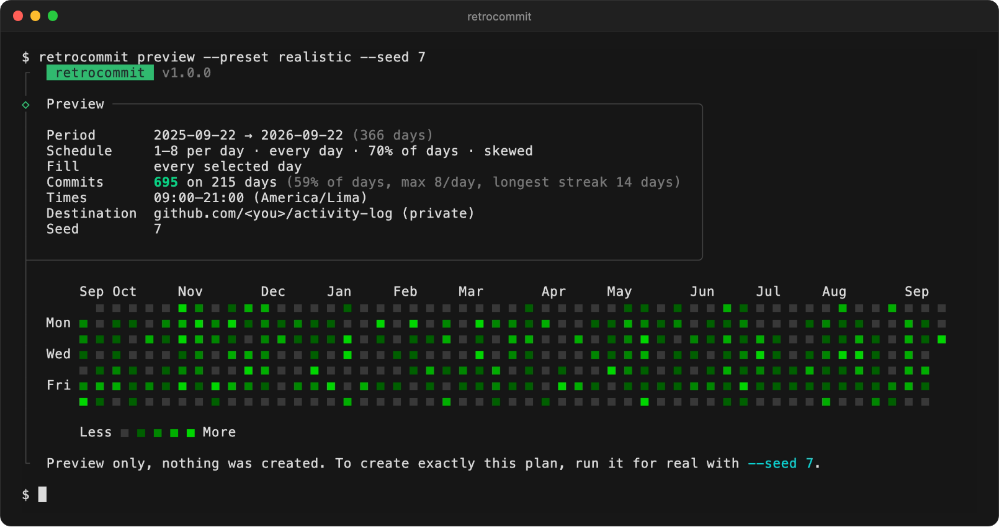
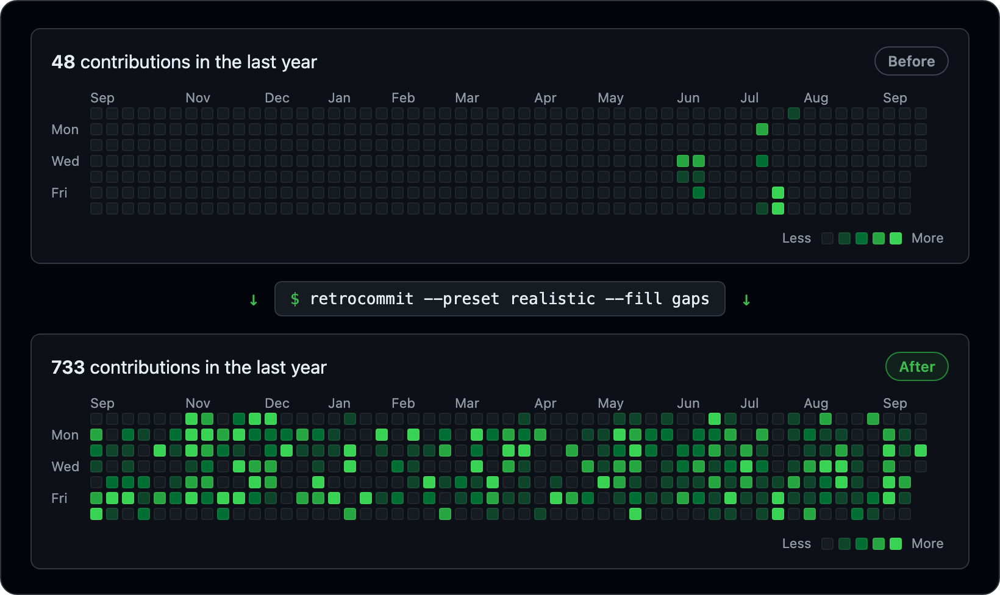

<div align="center">


# retrocommit

**Fill the gaps in your GitHub contribution graph, straight from your terminal.**

Backdated commits, fully configurable: date ranges, fixed or random amounts, days of the week,
time windows, "only the empty days" mode, even text drawn on your graph.
One command creates the repository and pushes it.

[](https://www.npmjs.com/package/retrocommit)
[](https://www.npmjs.com/package/retrocommit)
[](https://github.com/abpineda/retrocommit/actions/workflows/ci.yml)
[](https://nodejs.org)
[](LICENSE)
[](CONTRIBUTING.md)

**English** · [Español](README.es.md)


</div>

---

## Table of contents

- [Why retrocommit?](#why-retrocommit)
- [Features](#features)
- [Requirements](#requirements)
- [Installation](#installation)
- [Quick start](#quick-start)
- [How it works](#how-it-works)
- [Usage](#usage)
  - [Interactive assistant](#interactive-assistant)
  - [Recipes](#recipes)
- [Commands](#commands)
- [Options](#options)
- [Configuration file](#configuration-file)
- [Authentication](#authentication)
- [Drawing on your graph](#drawing-on-your-graph)
- [Commit messages](#commit-messages)
- [Troubleshooting & FAQ](#troubleshooting--faq)
- [Responsible use](#responsible-use)
- [Contributing](#contributing)
- [Roadmap](#roadmap)
- [License](#license)

## Why retrocommit?

Your contribution graph only shows part of the story. Work on company Git servers, projects on
GitLab or Bitbucket, a hard drive full of side projects that never got pushed: none of it turns a
square green. **retrocommit** lets you fill those gaps however you like: exactly the days you
choose, with as many commits as you want, in a repository you control.

It's also just fun: write your name on your profile, draw pixel art, or try out what a "realistic"
year would look like before creating anything.

## Features

- 🗓️ **Any period**: exact dates, whole months, years, or relative (`6m`, `1y`).
- 🎲 **Fixed or random amounts** per day, with uniform, bell-curve or natural-looking distributions.
- 📆 **Pick the days**: days of the week, percentage of active days, per-day weights, and excluded dates (holidays, vacations).
- 🕘 **Realistic timestamps** inside a time window, in your time zone (daylight saving time included).
- 🕳️ **Only the gaps**: reads your real graph and skips, or tops up, days that already have contributions.
- ✍️ **Draw on your graph**: write text or pixel art.
- 🚀 **One command** creates the GitHub repository (private or public, in your account or an organization) and pushes to it.
- ⚡ **Fast**: uses `git fast-import`, so tens of thousands of commits take seconds.
- 🔁 **Reproducible**: every plan has a seed. Preview it, then create exactly the same thing.
- 🧙 **Three ways to use it**: an interactive assistant, flags for scripts, or a JSON/YAML config file with editor autocompletion.
- 🧯 **Safe by design**: validates everything, has previews and confirmations, never writes your token to disk, and `delete` undoes a run.
- 🖥️ **Cross-platform**: macOS, Linux and Windows, entirely in the terminal.

## Requirements

- [Node.js](https://nodejs.org) **22.12 or newer**
- [Git](https://git-scm.com/downloads) **2.20 or newer** (2.31+ recommended)
- A GitHub account and a [token](#authentication) (to create repositories for you)

## Installation

```bash
npm install --global retrocommit
```

Or run it without installing anything:

```bash
npx retrocommit
```

<details>
<summary>pnpm, Yarn and Bun</summary>

```bash
pnpm add --global retrocommit     # or: pnpm dlx retrocommit
yarn global add retrocommit       # or: yarn dlx retrocommit
bun add --global retrocommit      # or: bunx retrocommit
```

</details>

Check that everything is ready:

```bash
retrocommit doctor
```

## Quick start

**1. Create a token.** [This link](https://github.com/settings/tokens/new?scopes=repo&description=retrocommit)
opens GitHub's "new token" page with the right scope (`repo`) already selected.

**2. Make it available** in your terminal (it's never saved to disk by retrocommit):

```bash
# macOS / Linux
export RETROCOMMIT_TOKEN=ghp_your_token

# Windows (PowerShell)
$env:RETROCOMMIT_TOKEN = "ghp_your_token"
```

> Already use the [GitHub CLI](https://cli.github.com)? Then skip this step: retrocommit uses its login automatically.

**3. Run it.** Without options, a short assistant asks everything it needs:

```bash
retrocommit
```

Or go straight to the point: preview first, then create it:

```bash
retrocommit preview --from 2024-01-01 --to 2024-12-31 --commits 1-8 --seed 42
retrocommit         --from 2024-01-01 --to 2024-12-31 --commits 1-8 --seed 42
```

<div align="center">

</div>

## How it works

1. **Plans every day.** From your options (and a seed), retrocommit decides how many commits each day gets. The plan is deterministic: the same options and seed always give the same result, so the preview is exactly what gets created.
2. **Writes the history in one go.** Instead of running `git commit` thousands of times, it streams every commit, each with its exact author and committer date, into [`git fast-import`](https://git-scm.com/docs/git-fast-import). That's why it's fast.
3. **Gets the dates right.** GitHub places commits on the calendar [using the time zone stored in each commit](https://docs.github.com/en/account-and-profile/reference/profile-contributions-reference), so retrocommit writes times in *your* time zone, daylight saving time included.
4. **Makes sure they count.** Commits are authored with your GitHub no-reply address (`ID+user@users.noreply.github.com`), which is always linked to your account. They go to the default branch of a repository you own, which is what [GitHub requires](https://docs.github.com/en/account-and-profile/setting-up-and-managing-your-github-profile/managing-contribution-settings-on-your-profile/why-are-my-contributions-not-showing-up-on-my-profile).
5. **Creates and pushes.** It creates the repository through the GitHub API and pushes over HTTPS. The token goes through git's environment only: never in the URL, in `.git/config`, or on disk.

<div align="center">

</div>

## Usage

### Interactive assistant

Run `retrocommit` without options in a terminal. It asks for:

1. The period (last 12 months, this year, a specific year, or a custom range)
2. What to create (commits on a schedule, text on your graph, or a pattern file)
3. Commits per day (random range or fixed), days of the week, and how often
4. What to do with days that already have contributions
5. Where the commits go (new GitHub repository, existing remote, or only a local folder)

It then shows the plan and the graph, asks for confirmation, and at the end offers to save your
answers to `retrocommit.config.json` so you can reuse them.

Add `-i` to open the assistant even when you pass other options or have a config file.

### Recipes

**Fill the last 12 months** (the default period):

```bash
retrocommit --commits 1-6
```

**Fill a specific year:**

```bash
retrocommit --year 2023
```

**Weekdays only, most days, with a bell curve of 2–10 commits:**

```bash
retrocommit --from 2024-01 --to 2024-06 --days weekdays --frequency 85 --commits 2-10 --distribution normal
```

**Natural-looking activity** (fewer weekends, mostly small days, a few busy ones):

```bash
retrocommit --preset realistic
```

| Preset      | Commits per day | Active days | Notes                              |
| ----------- | --------------- | ----------- | ---------------------------------- |
| `casual`    | 1–3             | 45%         | half as likely on weekends, skewed |
| `realistic` | 1–8             | 70%         | quieter weekends, skewed           |
| `workweek`  | 2–8             | 90%         | Monday to Friday, bell curve       |
| `intense`   | 5–20            | 100%        | every day, bell curve              |

Any option you pass overrides the preset: `--preset realistic --commits 1-12`.

**Only the days without contributions** (reads your real graph):

```bash
retrocommit --from 1y --fill gaps
```

**Top up quiet days** so every day reaches at least 3 contributions:

```bash
retrocommit --fill top-up --commits 3
```

**Skip holidays and vacations:**

```bash
retrocommit --year 2024 --exclude 2024-12-24..2024-12-31 --exclude 2024-08
```

**Commit late at night, in another time zone:**

```bash
retrocommit --time 21:00-23:59 --timezone America/Mexico_City
```

**Your own commit messages:**

```bash
retrocommit --message "chore: daily notes for {date} ({n}/{count})"
retrocommit --messages-file ./messages.txt     # one message per line, picked at random
```

**Write on your graph or draw a pattern:**

```bash
retrocommit --text "HELLO" --public
retrocommit --pattern ./examples/heart.txt --year 2024
```

**Public repository, a custom name, or an organization:**

```bash
retrocommit --public --repo my-activity --description "Things I did"
retrocommit --owner my-org --repo activity
```

**Add more commits later, or start over:**

```bash
retrocommit --from 2025-01-01 --to 2025-03-31 --if-exists append    # on top of the existing history
retrocommit --year 2025 --if-exists replace                           # overwrite what retrocommit created
```

**Only create the repository locally** and push it yourself:

```bash
retrocommit --no-push --output ./my-history
```

**Push to a repository you already have** (GitHub over SSH, GitLab, Gitea, Bitbucket…), using your own git credentials:

```bash
retrocommit --remote git@github.com:you/activity.git
retrocommit --remote https://gitlab.com/you/activity.git
```

**GitHub Enterprise Server:**

```bash
retrocommit --host github.mycompany.com
```

**Scripts and CI** (no questions, machine-readable output):

```bash
retrocommit --config ./retrocommit.config.yaml --yes --json
```

## Commands

| Command                     | Description                                                                           |
| --------------------------- | ------------------------------------------------------------------------------------- |
| `retrocommit [options]`     | Plan the commits, show them, ask for confirmation, create them and push.              |
| `retrocommit preview`       | Show the plan and the graph without creating anything. Alias: `plan`, or `--dry-run`. |
| `retrocommit init`          | Create a config file with the assistant, or a documented template (`--defaults`).     |
| `retrocommit graph`         | Draw your real contribution graph (or anyone's, with `--user`) in the terminal.       |
| `retrocommit doctor`        | Check Node.js, git, your token, its permissions and your rate limit.                  |
| `retrocommit delete <repo>` | Delete a repository created by retrocommit: the undo button. Alias: `remove`.         |

Run `retrocommit <command> --help` to see the options of each command.

## Options

Every option also works in a [configuration file](#configuration-file), using its camelCase name
(`--max-commits` → `maxCommits`).

<details open>
<summary><b>Date range</b></summary>

| Flag                | Config key    | Default  | Description                                                                               |
| ------------------- | ------------- | -------- | ----------------------------------------------------------------------------------------- |
| `-f, --from <date>` | `from`        | `1y`     | First day: `2024-01-15`, `2024-03`, `2024`, `today`, `yesterday` or relative (`30d`, `12w`, `6m`, `1y`). |
| `-t, --to <date>`   | `to`          | `today`  | Last day (same formats).                                                                  |
| `--year <year>`     | `year`        |          | A whole calendar year (instead of `--from`/`--to`).                                       |
| `--exclude <dates>` | `exclude`     |          | Days to skip: `2024-12-25`, `2024-08` or `2024-08-01..2024-08-15`. Repeatable.            |
| `--allow-future`    | `allowFuture` | `false`  | Allow dates after today.                                                                  |
| `--timezone <zone>` | `timezone`    | system   | IANA time zone (`Europe/Madrid`), `UTC` or an offset (`+05:30`).                          |

</details>

<details open>
<summary><b>Schedule</b></summary>

| Flag                        | Config key     | Default       | Description                                                                          |
| --------------------------- | -------------- | ------------- | ------------------------------------------------------------------------------------ |
| `-c, --commits <n\|min-max>` | `commits`      | `1-5`         | Commits per active day: fixed (`5`) or random (`1-10`). Max 1000.                    |
| `--distribution <type>`     | `distribution` | `uniform`     | `uniform`, `normal` (bell curve) or `skewed` (mostly low, looks natural).            |
| `--frequency <percent>`     | `frequency`    | `100`         | Percentage of the selected days that get commits.                                    |
| `--days <days>`             | `days`         | `all`         | `all`, `weekdays`, `weekends`, lists (`mon,wed,fri`) or ranges (`mon-fri`).          |
| `--weights <weights>`       | `weights`      |               | Relative chance per day of the week, e.g. `sat=0.3,sun=0.2`.                         |
| `--fill <mode>`             | `fill`         | `all`         | `all` days, only `gaps` (days without contributions) or `top-up` to the target.       |
| `--preset <name>`           | `preset`       |               | `casual`, `realistic`, `workweek` or `intense`.                                      |
| `--time <from-to>`          | `time`         | `09:00-21:00` | Local time window for the commits.                                                   |
| `--seed <value>`            | `seed`         | random        | Reproduce exactly the same plan.                                                     |
| `--max-commits <n>`         | `maxCommits`   | `50000`       | Safety limit for the total number of commits.                                        |

</details>

<details open>
<summary><b>Drawing</b></summary>

| Flag               | Config key  | Default | Description                                                  |
| ------------------ | ----------- | ------- | ------------------------------------------------------------ |
| `--text <text>`    | `text`      |         | Write text on your graph ([details](#drawing-on-your-graph)). |
| `--pattern <file>` | `pattern`   |         | Draw a pattern file.                                          |
| `--intensity <n>`  | `intensity` | `12`    | Commits for the darkest squares.                              |

</details>

<details open>
<summary><b>Commits</b></summary>

| Flag                       | Config key     | Default                              | Description                                               |
| -------------------------- | -------------- | ------------------------------------ | --------------------------------------------------------- |
| `-m, --message <template>` | `message`      | `Update activity log ({date} #{n})`  | Message template ([placeholders](#commit-messages)).      |
| `--messages-file <file>`   | `messagesFile` |                                      | Pick messages at random from a file (one per line).       |
| `--author-name <name>`     | `authorName`   | your GitHub name                     | Commit author name.                                       |
| `--author-email <email>`   | `authorEmail`  | your GitHub no-reply email           | Commit author email. It must be linked to your account.   |
| `--content <mode>`         | `content`      | `single`                             | What commits change: `single` log file, `daily` files, or `empty`. |
| `--content-path <path>`    | `contentPath`  | `activity.log` / `activity`          | The log file (`single`) or folder (`daily`).              |
| `--readme [file]`          | `readme`       | on                                   | Add a README.md (optionally your own). `--no-readme` to skip it. |

</details>

<details open>
<summary><b>Repository</b></summary>

| Flag                     | Config key    | Default                                   | Description                                                         |
| ------------------------ | ------------- | ----------------------------------------- | ------------------------------------------------------------------- |
| `-r, --repo <name>`      | `repo`        | `activity-log`                            | Repository name.                                                    |
| `--owner <org>`          | `owner`       | you                                       | Create the repository in an organization.                           |
| `--private` / `--public` | `visibility`  | private                                   | Repository visibility.                                              |
| `--description <text>`   | `description` | `Activity log generated with retrocommit` | Repository description.                                             |
| `--topics <list>`        | `topics`      | `retrocommit`                             | Comma-separated topics. `delete` and `replace` look for `retrocommit`. |
| `--branch <name>`        | `branch`      | `main`                                    | Branch to write (for existing repositories: their default branch).  |
| `--if-exists <action>`   | `ifExists`    | `fail`                                    | If the repository has commits: `fail`, `append` or `replace`.       |
| `--force`                |               |                                           | Allow `replace` on repositories not created by retrocommit.         |
| `--no-push`              | `push`        | push                                      | Only create the repository locally.                                 |
| `-o, --output <dir>`     | `output`      |                                           | Keep the generated repository in this folder.                       |
| `--remote <url>`         | `remote`      |                                           | Push to an existing remote with your own git credentials.           |
| `--protocol <protocol>`  | `protocol`    | `https`                                   | Push to GitHub with the token (`https`) or your SSH keys (`ssh`).    |

</details>

<details open>
<summary><b>GitHub, configuration and output</b></summary>

| Flag                | Config key | Default      | Description                                                    |
| ------------------- | ---------- | ------------ | -------------------------------------------------------------- |
| `--token <token>`   |            |              | GitHub token. Prefer the `RETROCOMMIT_TOKEN` environment variable. |
| `--host <host>`     | `host`     | `github.com` | GitHub Enterprise Server host.                                 |
| `--api-url <url>`   | `apiUrl`   |              | GitHub API URL, if it isn't `https://<host>/api/v3`.           |
| `--config <file>`   |            | auto         | Read options from this JSON/YAML file.                         |
| `--no-config`       |            |              | Ignore configuration files.                                    |
| `-i, --interactive` |            |              | Open the assistant.                                            |
| `-y, --yes`         |            |              | Don't ask for confirmation (required outside a terminal).      |
| `--dry-run`         |            |              | Only show the plan (same as `retrocommit preview`).            |
| `--json`            |            |              | Machine-readable output.                                       |
| `-q, --quiet`       |            |              | Print only errors and the final result.                        |
| `--verbose`         |            |              | Print debugging details.                                       |
| `--no-graph`        |            |              | Don't draw the graph.                                          |
| `--ascii`           |            |              | Plain ASCII output (for old terminals).                        |
| `--no-color`        |            |              | Disable colors (`NO_COLOR` is honored too).                    |

</details>

**Exit codes:** `0` success · `1` error · `2` invalid options or confirmation needed · `130` cancelled.

## Configuration file

Keep your favorite setup in a file and run `retrocommit` in that folder. It looks for, in order:
`retrocommit.config.json`, `retrocommit.config.yaml`, `retrocommit.config.yml`, `.retrocommitrc`,
`.retrocommitrc.json`, `.retrocommitrc.yaml`, `.retrocommitrc.yml`. You can also use `--config <file>`.

Create one with the assistant, or get a fully documented template:

```bash
retrocommit init                     # asks questions
retrocommit init --defaults --format yaml
```

```yaml
# yaml-language-server: $schema=https://cdn.jsdelivr.net/npm/retrocommit/schema.json
from: 2024-01-01
to: 2024-12-31
preset: realistic
commits: 1-10
exclude:
  - 2024-12-24..2024-12-31
time: 10:00-19:00
timezone: Europe/Madrid
fill: gaps
repo: activity-log
visibility: private
```

- Precedence: **defaults < preset < config file < assistant answers < flags**.
- Relative paths (`messagesFile`, `pattern`, `output`, `readme`) are resolved from the file's folder.
- Unknown keys are errors (with a "did you mean…?" suggestion), so typos never go unnoticed.
- The [JSON Schema](schema.json) gives you autocompletion and validation in VS Code and other editors.
- Tokens are **not** allowed in config files. Use an environment variable.

More examples live in [`examples/`](examples).

## Authentication

retrocommit looks for a token in this order:

1. `--token <token>` (avoid it: it stays in your shell history)
2. The `RETROCOMMIT_TOKEN`, `GH_TOKEN` or `GITHUB_TOKEN` environment variables (`GH_ENTERPRISE_TOKEN` / `GITHUB_ENTERPRISE_TOKEN` for Enterprise hosts)
3. The [GitHub CLI](https://cli.github.com), if you're logged in (`gh auth token`)
4. A hidden prompt, when running in a terminal

It's only kept in memory for the current run. Git receives it through environment variables, so
it never appears in the remote URL, in `.git/config`, in the process list (git 2.31+), or in any
error message.

**Classic token** ([create one](https://github.com/settings/tokens/new?scopes=repo&description=retrocommit)):

| Scope         | Needed for                                                                 |
| ------------- | -------------------------------------------------------------------------- |
| `repo`        | Creating private repositories and pushing to them (includes public ones).  |
| `public_repo` | Enough if you only use `--public`.                                          |
| `delete_repo` | Only for `retrocommit delete`.                                              |

**Fine-grained token**: give it access to *All repositories* with these repository permissions:
**Administration: Read and write** (create repositories, set topics, delete them) and
**Contents: Read and write** (push). Metadata (read) is added automatically.

**SSH instead of HTTPS**: with `--protocol ssh`, the token is used only for the API calls, and
the push goes through your SSH keys. With `--remote <url>`, retrocommit doesn't need a token at
all, except for `--fill gaps` / `top-up`.

## Drawing on your graph

**Text** (`--text "HELLO"`) uses a built-in font 5 squares tall, drawn from Monday to Friday. It
supports `A–Z`, `0–9`, space and `! ? . , : ; ' " - _ + = * / \ ( ) [ ] < > # @ & % $ ^ | ♥ ★`.
About 8–10 characters fit in a year.

Where it goes:

- **By default**: centered in the 52 full weeks your profile shows. As weeks pass, that view slides, so the drawing moves left and eventually leaves the default view.
- **`--year 2024`**: centered in that year's view on your profile, where it stays forever.
- **`--from <date>`**: starting at the first full week on or after that date.

**Patterns** (`--pattern art.txt`) are text files of up to 7 lines, Sunday to Saturday, one
character per week. `.`, a space or `0` leave a square empty; `1`–`4` set the intensity; any
other character means `4`. Files with fewer than 7 lines are centered vertically.

```text
.##...##.
#..#.#..#
#...#...#
.#.....#.
..#...#..
...#.#...
....#....
```

GitHub colors each day relative to your busiest days. If you already have days with many
contributions, raise `--intensity` so the drawing uses the darkest green. Existing contributions
on "empty" squares can't be removed, so the cleanest results come from quiet years
(and `--fill top-up`).

## Commit messages

`--message` and every line of `--messages-file` are templates:

| Placeholder  | Example                     | Placeholder | Example        |
| ------------ | --------------------------- | ----------- | -------------- |
| `{date}`     | `2024-03-05`                | `{n}`       | `2` (in the day) |
| `{time}`     | `14:23:11`                  | `{count}`   | `5` (that day) |
| `{datetime}` | `2024-03-05T14:23:11+01:00` | `{i}`       | `42` (overall) |
| `{weekday}`  | `Tuesday`                   | `{total}`   | `1230`         |
| `{year}`     | `2024`                      | `{month}`   | `03`           |
| `{day}`      | `05`                        |             |                |

Use `{{` and `}}` for literal braces. In a messages file, blank lines and lines starting with `#`
are ignored. See [`examples/messages.txt`](examples/messages.txt).

## Troubleshooting & FAQ

<details>
<summary><b>My contributions don't show up</b></summary>

1. **Wait a bit.** GitHub can take [up to 24 hours](https://docs.github.com/en/account-and-profile/setting-up-and-managing-your-github-profile/managing-contribution-settings-on-your-profile/why-are-my-contributions-not-showing-up-on-my-profile) to refresh the graph.
2. **Private repository?** Enable *Include private contributions on my profile* in [Settings → Public profile → Contributions & activity](https://github.com/settings/profile). Without it, visitors don't see them.
3. **Custom `--author-email`?** It must be a verified email of your account ([Settings → Emails](https://github.com/settings/emails)). The default no-reply address always works.
4. **Pushed to an existing repository?** Only commits on its **default branch** count, and never in forks.

</details>

<details>
<summary><b>"Your push would publish a private email address" (GH007)</b></summary>

You used `--author-email` with an address you keep private on GitHub. Remove `--author-email` so
your no-reply address is used.

</details>

<details>
<summary><b>Token errors (401, 403, missing scopes)</b></summary>

Run `retrocommit doctor`: it tells you which token it found, whose it is, and which scopes it has.
Create a new token with [this link](https://github.com/settings/tokens/new?scopes=repo&description=retrocommit)
if needed.

</details>

<details>
<summary><b>The repository already exists</b></summary>

By default retrocommit refuses to touch a repository that already has commits. Use
`--if-exists append` to add commits on top, `--if-exists replace` to overwrite a repository
created by retrocommit, or `--repo` to use another name. If a run failed after creating the
repository, running it again reuses the empty repository.

</details>

<details>
<summary><b>Behind a corporate proxy</b></summary>

Set `HTTPS_PROXY` and `NODE_USE_ENV_PROXY=1` so Node.js uses it for API calls. Git uses its own
proxy settings (`git config --global http.proxy …`).

</details>

<details>
<summary><b>Windows</b></summary>

retrocommit works in PowerShell, Command Prompt and Windows Terminal. Install
[Git for Windows](https://git-scm.com/download/win), or run `winget install --id Git.Git -e`, and
open a new terminal. If squares or symbols look broken in an old console, add `--ascii`.

</details>

<details>
<summary><b>How do I undo it?</b></summary>

```bash
retrocommit delete activity-log
```

Deleting the repository removes its contributions from your graph. `delete` only removes
repositories that have the `retrocommit` topic (unless you add `--force`) and asks you to type the
name to confirm. It needs a token with the `delete_repo` scope; you can also delete it from the
repository's settings on GitHub.

</details>

<details>
<summary><b>Does it work with GitLab, Gitea or Bitbucket?</b></summary>

Yes, with `--remote <url>`: create the repository there, then push to it with your own credentials.
Their contribution graphs follow their own rules (usually: the email must belong to your account).

</details>

## Responsible use

retrocommit creates ordinary commits with custom dates in a repository you own. How you use it is
up to you, but please be honest: a contribution graph says little about someone's skills, and it
shouldn't be used to mislead employers, clients or anyone else. Read GitHub's
[Terms of Service](https://docs.github.com/en/site-policy/github-terms/github-terms-of-service) and use it at your own risk.
This software is provided "as is", without warranty of any kind (see the [license](LICENSE)).

## Contributing

Contributions are very welcome: bug reports, ideas, docs and code. Start with
[CONTRIBUTING.md](CONTRIBUTING.md).

```bash
git clone https://github.com/abpineda/retrocommit.git
cd retrocommit
npm install
npm test          # unit, integration (real git) and end-to-end tests
npm run build     # bundles dist/cli.js
node dist/cli.js preview --preset realistic
```

Please read the [Code of Conduct](CODE_OF_CONDUCT.md). Security issues go through the
[security policy](SECURITY.md).

## Roadmap

- [ ] Standalone binaries (no Node.js needed) and Homebrew / Scoop / WinGet packages
- [ ] Shell completions
- [ ] More fonts and built-in patterns
- [ ] Translations of the command-line interface

Have an idea? [Open a feature request](https://github.com/abpineda/retrocommit/issues/new?template=feature_request.yml).

## License

[MIT](LICENSE) © 2026 abpineda

<div align="center">

If retrocommit helped you, consider giving it a ⭐ on GitHub.

</div>
